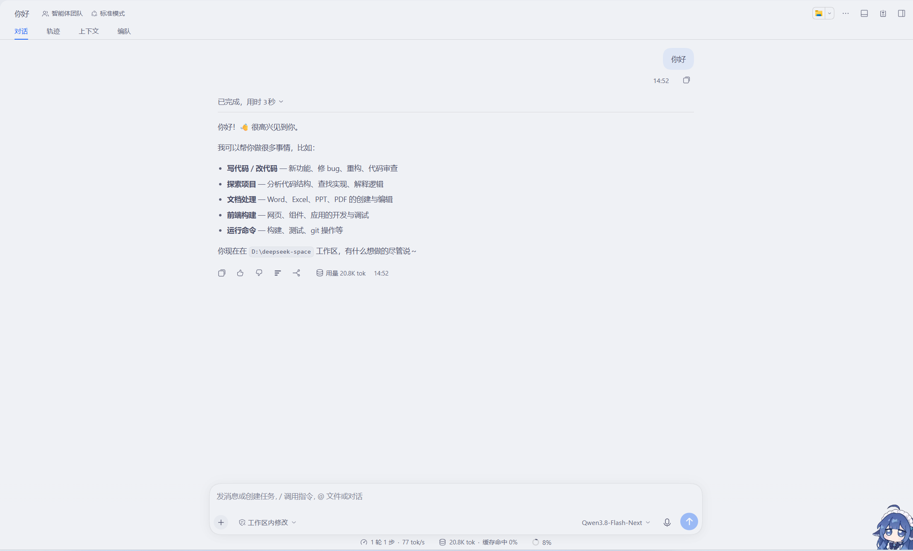
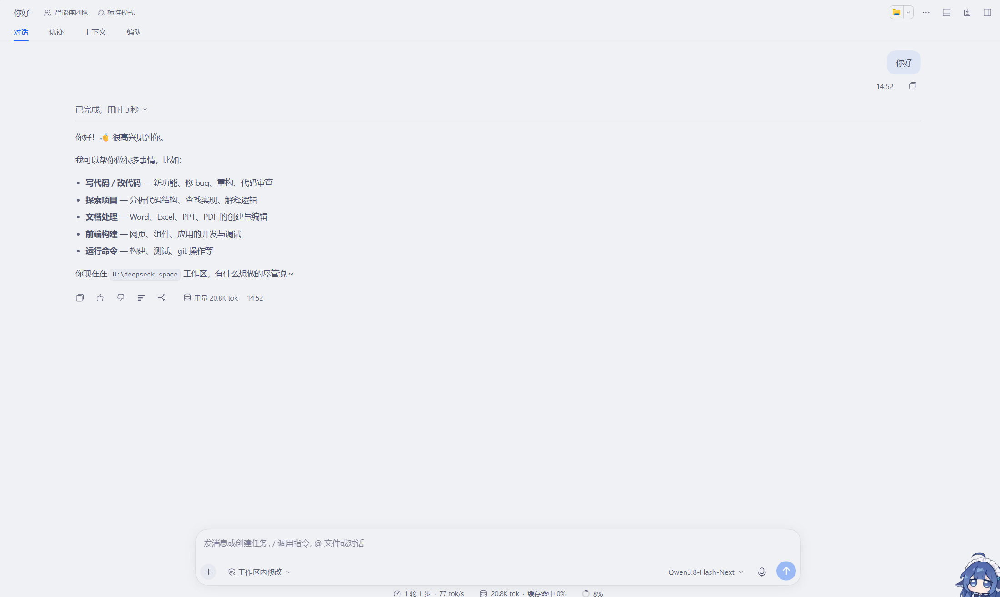

# @ray666/dsh-chat-width

为 DeepSeek Harness Web 界面提供独立的**对话内容宽度**与**输入框宽度**滑块。

官方界面在大屏幕上把对话列限制在 920px 以内，窗口两侧大量留白。本插件在 **设置 → 通用设置** 中新增两个独立滑块：

| 设置项 | 控制对象 | 默认值 |
| --- | --- | --- |
| 对话内容宽度 | 回答 / 用户消息内容列 | 与未安装插件时完全一致（恢复默认 → 官方行为） |
| 输入框宽度 | 底部输入卡片及其上方队列 | 跟随对话内容宽度（官方为内容宽 + 32px） |

两行滑块在**未手动拖动前完全不生效**：没有保存过数值时，插件不注入任何 CSS，页面与不装插件时一模一样。宽度以**像素**保存，标签直接显示真实数值（`1200px`）或状态（`默认` / `跟随内容`）。

## 效果图

| 默认（已安装、未调整） | 两个滑块调整后 |
| --- | --- |
|  |  |

## 原理

官方在对话容器上声明：

```css
--dsh-chat-content-width: var(--dsh-chat-user-width, clamp(680px, calc(var(--dsh-conversation-column-width,0px) * .64), 920px));
--dsh-composer-card-max-width: calc(var(--dsh-chat-content-width) + 32px);
```

本插件把两个变量解耦：

- **对话内容宽度**：在对话根元素（`div:has(> [data-conversation-content])`）上声明 `--dsh-chat-user-width`——官方正是把 `--dsh-conversation-column-width` 和拖拽覆盖值写在这个元素上，因此 176px 边缘预算与内置拖拽把手在页面内继续可用。
- **输入框宽度**：通过 `div:has(> [data-conversation-scroll]):not([class*="embeddedBody"])` 选择器直接在对话容器元素上覆盖 `--dsh-composer-card-max-width`，同元素声明必然压过继承值，且不依赖宿主哈希类名。嵌入式对话小窗保持官方宽度。

每条规则都是一个固定像素宽度，并用当前列宽做上限，永不溢出：`max(680px, min(<宽度>px, calc(var(--dsh-conversation-column-width,0px) - 176px)))`。**两行共用同一个 176px 边缘预算**，因此设定好的宽窄关系（谁比谁宽）在任何窗口宽度下都保持不变——窗口变窄时两者同步收缩，而不是输入框保留额外余量、反过来超过对话内容宽度。刻意用像素而不用百分比：输入框变量会被多层层级读取（hero 宽度 → hero 栈 → 卡片），百分比会在每层更小的包含块上重新解析，导致卡片被逐级缩小、与 hero 区域错位；像素值只替换一次，各层看到同一个宽度，而 `calc` 上限仍能随窗口/侧栏变化自适应，无需 JS 测量。

官方自带对话区边缘拖拽调宽（记忆键 `dsh.conversation.contentWidth`）。安装期间由插件接管该记忆，让滑块数值在刷新后保持权威；当前页面内仍可用边缘拖拽微调。任一行点 **恢复默认** 即交还官方行为。

偏好保存在 `localStorage`：`dsh-chat-width.contentPx` / `dsh-chat-width.composerPx`（另有 `dsh-chat-width.col` 记录最近一次测得的列宽，仅用于对话视图被卸载时摆放滑块）。

## 安装

```
dsh plugin --profile <name> add dsh-chat-width
```

或在应用内插件管理器安装，安装后刷新 Web 页面。

## 卸载

先在两行上点 **恢复默认**（或手动清除上面两个 `localStorage` 键），再禁用/移除插件，把宽度交还官方逻辑。

## 许可

MIT
